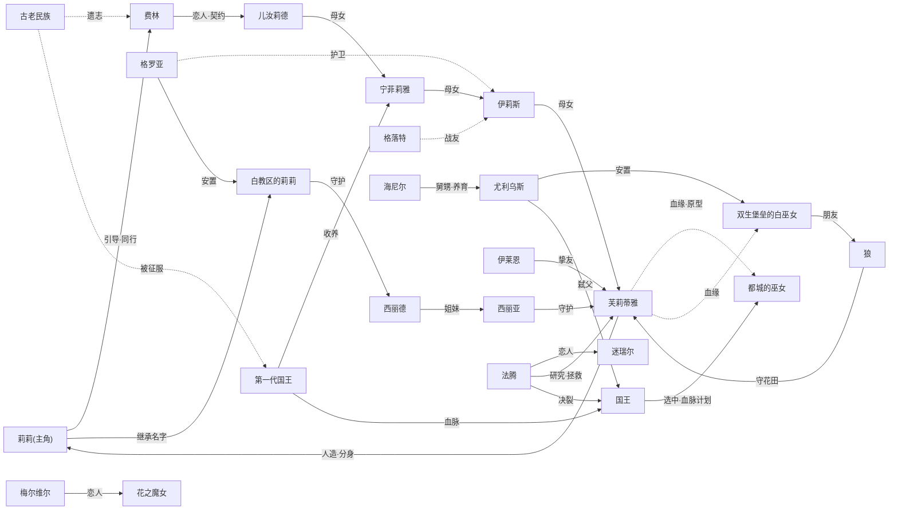

# Wiki Index — ENDER LILIES 文本集

> 基于双基准与补充来源构建的游戏剧情知识库：`wiki/sources/ENDER LILIES 文本集.md`（基准）与 `剧情疑点与未解之谜的解释和推测.md`（同级可信）并列双基准；另参考 `ENDERLILIES剧情补完.md`（游戏实机/CG/解包整理）。
> 页面共 58 个：人物 40 · 事件 7 · 概念 10 · 悬案 1（2026-09-06）。
> 阅读入口：[[事件时间线]] 看剧情全貌 → [[剧情疑点与未解之谜]] 看叙事留白与裁定结论 → 人物/概念页看细节。
> 命名约定：人物、遗物、地点正式名称一律以文本集为准；正文仅对确属推断处标注「(推测)」，来源由各页 frontmatter 追溯。

---

# 人物关系图谱摘要

## 图谱总览

剧情以三条血脉/权力线交织：

- **白巫女传承线**（[[剧情疑点与未解之谜|血脉真相见疑点页]]）：古老民族巫女[[儿汝莉德]] → 女[[宁菲莉雅]]（黎明·第一代）→ 女[[伊莉斯]]（风·第二代）→ 女[[芙莉蒂雅]]（泉·第三代）→ 人造/分身[[莉莉]]；[[费林]]以不死契约贯穿全程，从恋人儿汝莉德守护到最后的莉莉。
- **王权线**：[[第一代国王]]征服并收养宁菲莉雅（赎罪与罪孽）→ 当代[[国王]]追求不死、以[[都城的巫女]]续血脉 → 私生子[[尤利乌斯]]手刃生父。
- **禁忌研究线**：[[法腾]]（灵药、人造白巫女、石板）与[[伊莱恩]]（护符、宝具修复）分别以扭曲与纯粹的方式缠绕芙莉蒂雅；九位幼年白巫女散落各地（[[白巫女]]概念页有安置表）。

死亡之雨是芙莉蒂雅体内污秽的外溢（结局 B），所有执念最终在莉莉的净化之旅中得到安放（结局 C）。

## 关系类型索引

| 关系类型 | 说明 | 主要例子 |
|---|---|---|
| 守护者—白巫女 | 以身殉职的护卫 | [[西丽德]]→[[白教区的莉莉]]；[[西丽亚]]→[[芙莉蒂雅]]；[[格罗亚]]→先代 |
| 姐妹/母女 | 血缘与传承 | 西丽亚×西丽德；儿汝莉德→宁菲莉雅→伊莉斯→芙莉蒂雅→莉莉 |
| 恋人 | 生死相隔的执念 | [[法腾]]×[[迷瑞尔]]；[[费林]]×[[儿汝莉德]]；[[梅尔维尔]]×[[花之魔女]] |
| 王族血亲 | 私生子/舅甥/父子/征服者 | [[尤利乌斯]]×[[国王]]×[[海尼尔]]；[[第一代国王]] |
| 分身/人造 | 芙莉蒂雅与九位人造白巫女 | [[莉莉]]、[[都城的巫女]]、[[双生堡垒的白巫女]]、[[白教区的莉莉]] |
| 挚友 | 白巫女与魔女 | [[伊莱恩]]×[[芙莉蒂雅]] |
| 契约 | 灵魂契约维系不死、随血脉传承 | [[费林]]×巫女血脉 |
| 敬慕/信仰 | 单向憧憬 | [[狼]]→芙莉蒂雅；[[西丽德]]→芙莉蒂雅；[[无头骑士]]→[[格落特]] |
| 效忠/上下级 | 军队与王权 | [[单眼的王之盾]]→国王；[[尤利乌斯]]统率[[不死骑士团]] |
| 被征服者—征服者 | 历史原罪 | [[古老民族]]×[[第一代国王]] |

---

# 目录

## 人物（40）

### 主角与白巫女
- [[莉莉]] — 主角：第九位人造白巫女，继承“莉莉”之名
- [[白教区的莉莉]] — “真莉莉”：西丽德守护者，名字的真正主人（沉睡于教区顶层）
- [[都城的巫女]] — 被国王选中的人造白巫女最年长者（血脉计划）
- [[双生堡垒的白巫女]] — 被尤利乌斯安置堡垒、与狼交友者
- [[费林]] — 黑色骑士，古老民族最后的不死战士
- [[芙莉蒂雅]] — 第三代白巫女（泉），死亡之雨之源的背负者
- [[伊莉斯]] — 第二代白巫女（风），芙莉蒂雅之母（补完推断）
- [[宁菲莉雅]] — 第一代白巫女（黎明），儿汝莉德之女
- [[儿汝莉德]] — 古老民族巫女，费林恋人，白巫女血脉之祖

### 守护者
- [[西丽德]] — 白教区守护者（守护真莉莉至狂气）
- [[西丽亚]] — 姐姐守护者，禁区实验的目击者与牺牲者
- [[格罗亚]] — 守护者之长（默许实验、安置真莉莉的复杂人物）

### 骑士与军队
- [[格落特]] — 都城第一骑士，自愿成为不死骑士的老英雄
- [[狼]] — 狂骑士，雪之花田的守护者
- [[尤利乌斯]] — 骑士长，弑君者（补完）
- [[无头骑士]]／[[腐龙的孤儿]]／[[堕落的弓兵]]／[[异变的守卫]]／[[单眼的王之盾]] — 军队与骑士的悲剧群像

### 魔术师
- [[伊莱恩]] — 黑色魔女，芙莉蒂雅的挚友
- [[法腾]] — 异端者，灵药与人造白巫女的制造者
- [[迷瑞尔]]／[[梅尔维尔]]（=[[菌之魔术师]]）／[[花之魔女]] — 禁忌研究与恋人悲剧

### 王族与暗部
- [[国王]] — 当代国王（不死执念与血脉计划）
- [[第一代国王]] — 征服者与收养者
- [[海尼尔]] — 暗部统领，尤利乌斯的舅舅
- [[暗部的执行人]] — 尤利乌斯的切磋伙伴

### 古老民族、信众与其他
- [[古老民族]] — 原住民，怨念化为污秽的民族
- [[贝尔]] — 白巫女专用的驭手（格罗亚书信褒奖者）
- [[悬崖村的少年]]／[[悬崖村村长]]／[[西方商人]]／[[老守墓人]]／[[城堡里的姑娘]]／[[隐藏的实验体]]／[[半秽变的罪犯]]／[[禁区的战士]] — 众生相

## 事件（7）
- [[事件时间线]] — 七幕推定年表（含两源差异标注）
- [[古老民族战争与建国]] — 征服、血脉存续与建国
- [[双生堡垒防御战]] — 污秽之王来袭的惨胜
- [[禁区实验与人造白巫女]] — 灵药、九位人造白巫女与污秽转移仪式
- [[死亡之雨降临]] — 国破之雨及其真相
- [[王城之乱与国王的末路]] — 尤利乌斯弑君与王权崩塌
- [[莉莉的旅途与三个结局]] — 结局 A 净化 / B 深渊 / C 尾声

## 概念（10）
- [[白巫女]] — 净化机制、血脉系谱与人造白巫女安置表
- [[不死契约与不死者]] — 契约传承链（儿汝莉德→…→莉莉）
- [[污秽与秽鬼]]／[[白教]]／[[魔术协会与国家魔术师团]]／[[暗部]]／[[王之盾]]／[[不死骑士团]]
- [[遗物宝具]] — 全遗物目录：主人、描述与象征意义
- [[舞台与地点]] — 十大地点的正式名称与补完异名对照（含各地点「相关人物」反查，与人物页「相关地点」双向索引）

## 悬案（1）
- [[剧情疑点与未解之谜]] — 13 组疑点：各条已给出裁定与统一解释，无法确认的留白如实保留
